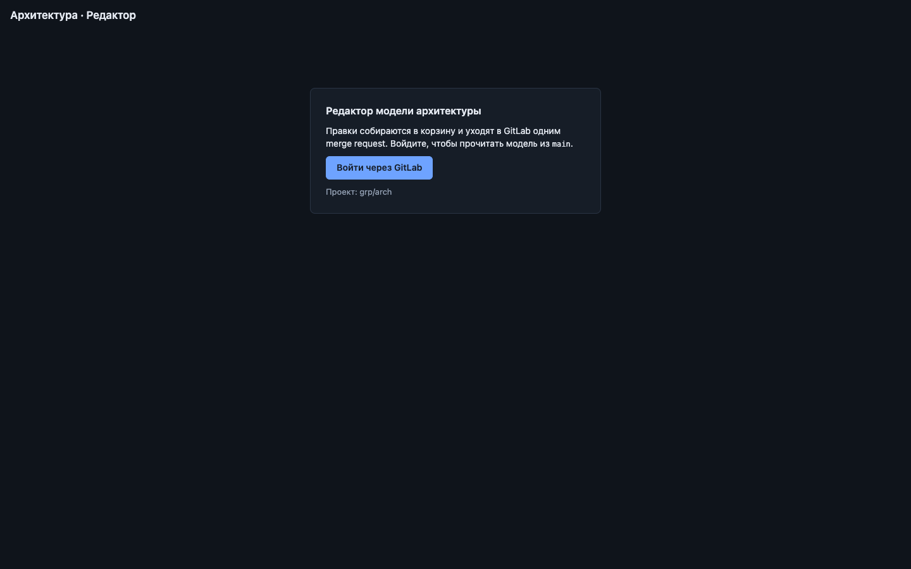
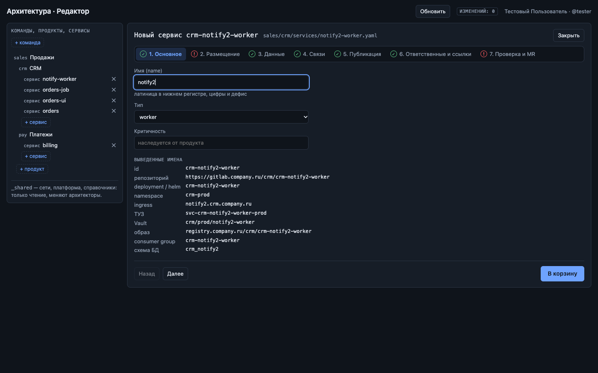
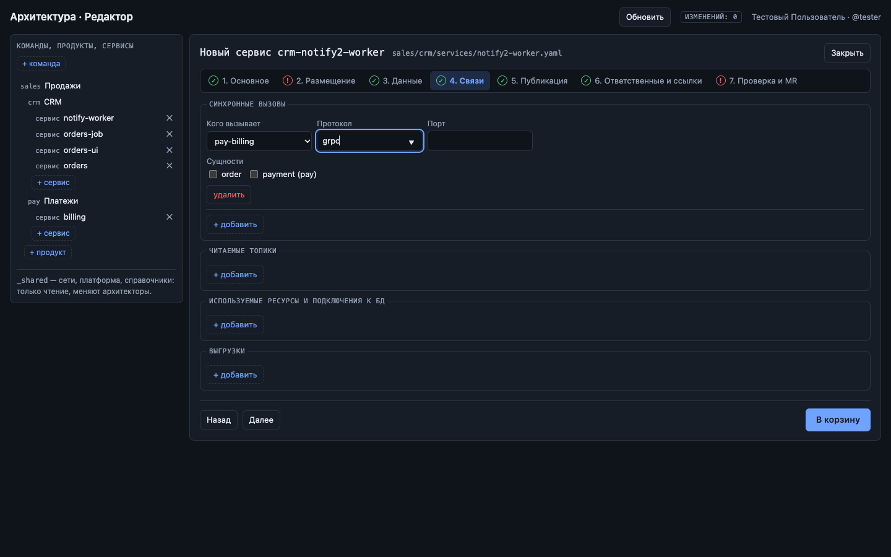
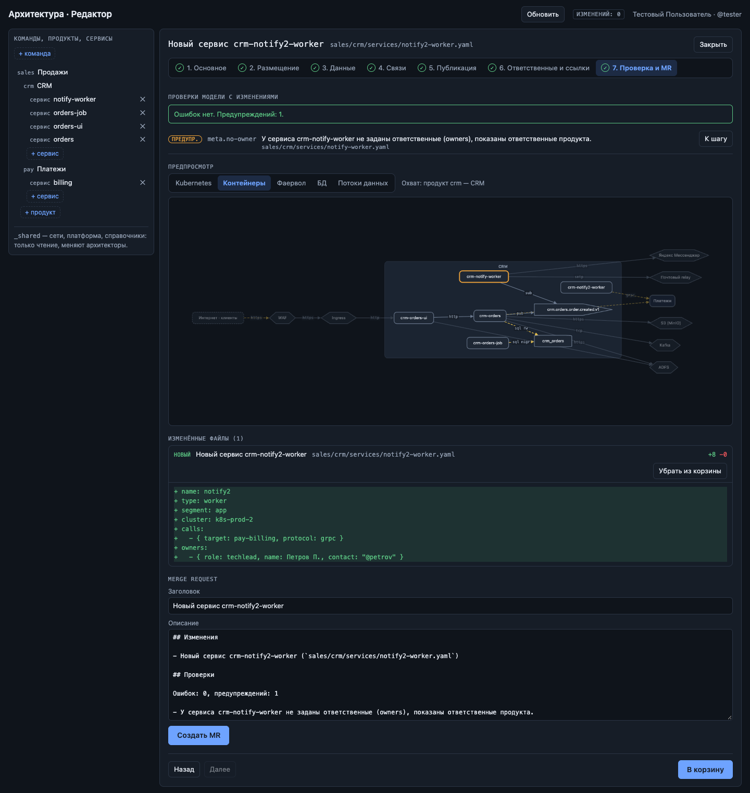
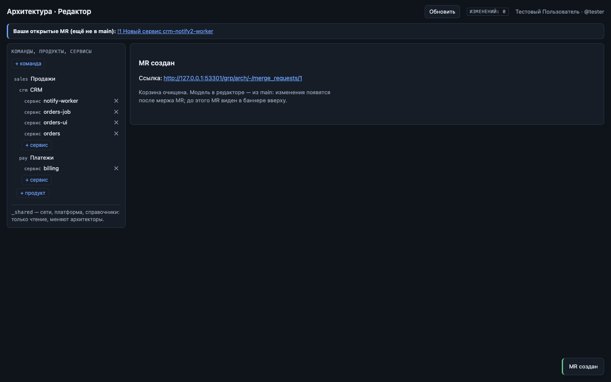
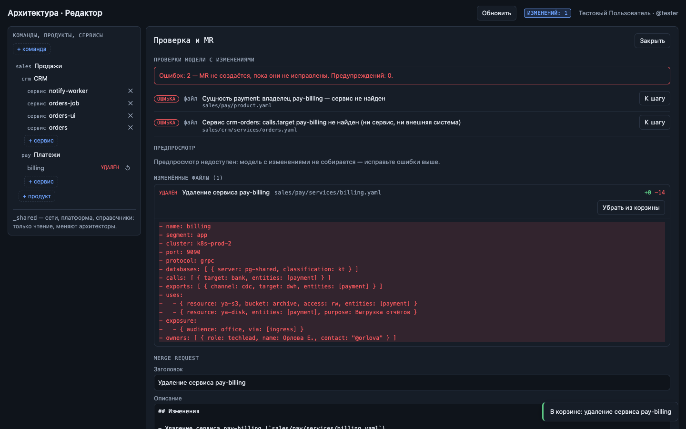
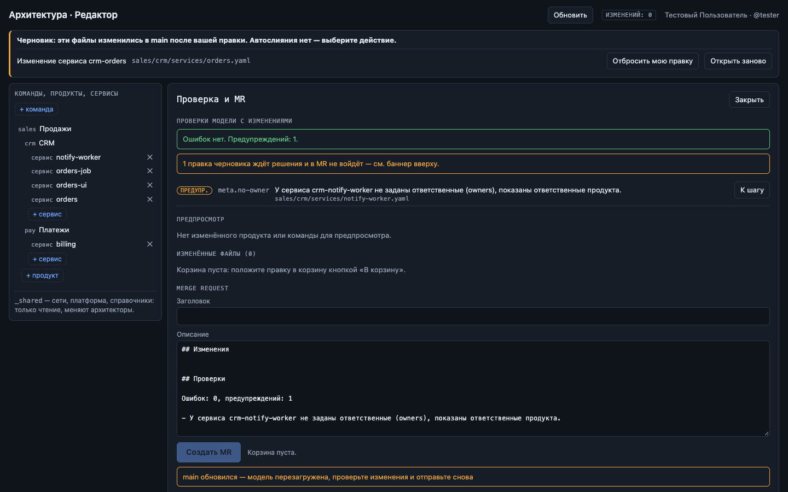
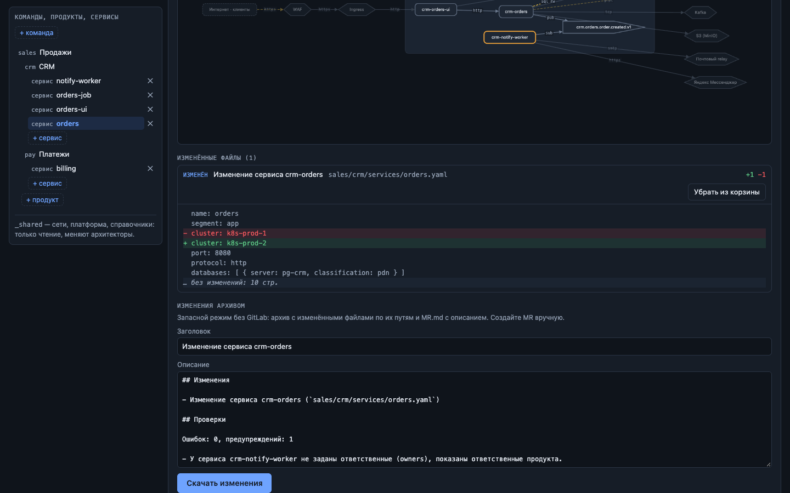

# Редактор модели: руководство пользователя

Редактор нужен тем, кто не правит YAML руками. Через него команда заводит и меняет свои команды, продукты и сервисы, сразу видит проверки и разрезы и отправляет изменения на ревью одним merge request в GitLab. Дальше идёт обычный процесс: CI с `arch:validate` и одобрение по `CODEOWNERS`.

Редактор открывается по адресу `…/editor/` рядом с просмотрщиком на GitLab Pages. Как его собрать и опубликовать, описано в [`_tool/README.md`](../_tool/README.md#редактор).

## Вход

Нажмите «Войти через GitLab». Редактор работает от вашего имени и с вашими правами: MR создаётся от вас, а ветку можно создать, только если у вас есть роль Developer в репозитории модели. Токен хранится только в памяти вкладки, поэтому после перезагрузки страницы нужен повторный вход. Если сессия в GitLab ещё активна, пароль вводить не придётся.

После входа редактор читает модель из `main`. Слева показано дерево команд, продуктов и сервисов. Вверху справа — кнопка «Обновить», счётчик «Изменений» (корзина) и ваше имя. Если у вас есть открытые MR из редактора, которые ещё не смержены, над деревом появится баннер со ссылками на них.

## Мастер

Кнопки в дереве:

- «+ команда», «+ продукт» в команде, «+ сервис» в продукте — создают новый элемент;
- клик по сервису — изменение существующего сервиса;
- ✕ у сервиса — удаление (после подтверждения).

Продукты и команды через редактор не удаляются. Файлы `_shared` (сети, платформа, справочники) только читаются: их меняют архитекторы обычным MR.

Шаги мастера сервиса: Основное, Размещение, Данные, Связи, Публикация, Ответственные и ссылки, Проверка и MR. Переходить между шагами можно в любом порядке. На каждом шаге стоит отметка: ✓ — ошибок нет, «!» — есть ошибки, относящиеся к этому шагу.

- **Основное.** Имя, тип и критичность. Ниже сразу показаны id и все имена, которые выводятся по регламенту: репозиторий, namespace, ТУЗ, путь в Vault, схема БД и т. д. У существующего сервиса имя и тип не меняются: это переименование, и оно идёт через архитектурный комитет.
- **Размещение, Данные, Связи, Публикация.** Ссылки на другие элементы модели (сегмент, кластер, сервер СУБД, ресурс, топик, вызываемый сервис, сущность, внешняя система) выбираются из списков, построенных по текущей модели. Сослаться на несуществующее нельзя.
- **Ответственные и ссылки.** Если ответственных нет, будут унаследованы ответственные продукта, и вы увидите предупреждение.

Поля, которых нет в мастере (например `overrides`), сохраняются как есть и показаны только для чтения с пометкой «меняется вручную в YAML».

Кнопка «В корзину» сохраняет правку. В одном MR может быть несколько изменений: например новый продукт, два его сервиса и правка третьего. Корзина сама сохраняется черновиком в браузере, поэтому закрытая вкладка работу не теряет.

## Проверка и MR

На последнем шаге собрано всё, что уйдёт в MR.

- **Проверки модели с изменениями.** Это те же правила, что в CI (`arch-views validate`), выполненные по всей модели с вашими правками. Ошибки блокируют кнопку «Создать MR», предупреждения нет. Кнопка «К шагу» открывает шаг, к которому относится находка.
- **Предпросмотр.** Пять разрезов изменяемого продукта (Kubernetes, контейнеры, фаервол, БД, потоки данных) с учётом правок.
- **Изменённые файлы.** Diff каждого файла. У существующего файла меняются только затронутые строки, а комментарии и форматирование остальных строк сохраняются. Если поле удаляется, вместе с ним уходит и его собственный комментарий в строке прямо над ним; шапка файла и заголовок раздела, отделённые пустой строкой, остаются. Кнопка «Убрать из корзины» отменяет правку файла.
- **Merge request.** Заголовок и описание заполнены автоматически, их можно поправить.

После «Создать MR» редактор создаёт ветку `arch/…` с одним коммитом и MR в `main` с меткой `arch-editor`, а затем показывает ссылку на него.

Корзина очищается. Модель в редакторе по-прежнему читается из `main`, поэтому ваши изменения появятся в ней после мержа MR. До этого MR виден в баннере вверху.

### Если MR недоступен

Пока в модели с вашими правками есть ошибки, MR не создаётся. Например, при удалении сервиса, на который ссылаются другие, видно, какие файлы ссылаются на него. Уберите ссылки в той же корзине или уберите удаление из корзины.

### Если main изменился

Если пока вы работали, кто-то смержил изменения в `main`, редактор при создании MR ничего не пишет в GitLab. Он перезагружает модель и сообщает: «main обновился — модель перезагружена, проверьте изменения и отправьте снова».

- Ваши правки файлов, которые в `main` не менялись, применяются снова. Проверьте сводку и нажмите «Создать MR» ещё раз.
- Если в `main` изменился тот же файл, что правили вы, правка попадает в баннер конфликтов. Автослияния нет, чужие изменения не перезаписываются. Выберите «Отбросить мою правку» или «Открыть заново»: мастер откроется с уже новой версией файла, и правку нужно повторить.

Если сессия GitLab истекла, редактор предложит войти снова. Корзина при этом сохранена в черновике и восстановится после входа.

## Запасной режим без GitLab

Если OAuth-приложение не настроено, редактор работает без входа. Модель берётся из `model.json`, собранного вместе с сайтом, а дата сборки показана в шапке. Мастер, проверки и предпросмотр работают так же, но вместо «Создать MR» есть кнопка «Скачать изменения». Она отдаёт zip с изменёнными файлами по их путям и `MR.md` с описанием. MR создаётся вручную от свежего `main`. Конфликты с `main` в этом режиме не обнаруживаются.

---

Скриншоты сняты с демо-модели командой `npm run editor:screens` из `_tool/` (нужен Chrome). Она же обновляет их после изменений интерфейса.
