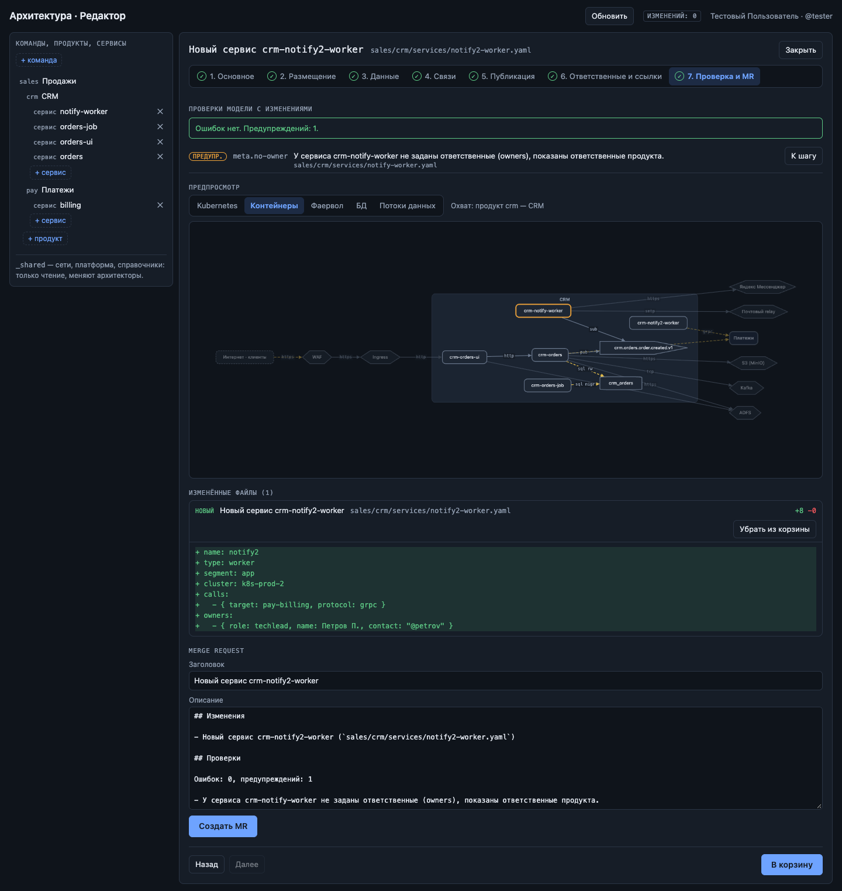

# arch-views

Инструмент строит из YAML-описания архитектуры самодостаточный `index.html` (5 разрезов: Kubernetes, контейнеры, фаервол, БД, потоки данных), файлы Mermaid и проверяет модель на нарушения правил. Работает без сети.

Каталог `arch/_prototype/` — одноразовый прототип, не часть инструмента и в сборке не участвует.

## Структура модели

Корень модели — каталог `arch/`. Каталоги, имена которых начинаются с `_` (кроме `_shared`), пропускаются.

```
arch/
  _shared/network.yaml     # сегменты, актёры, явные соединения
  _shared/platform.yaml    # домен, registry, git, кластеры, общие ресурсы, внешние системы, серверы СУБД
  <team>/team.yaml
  <team>/<product>/product.yaml
  <team>/<product>/services/<service>.yaml
```

Полный пример формата: [`examples/demo`](examples/demo). Схемы запрещают лишние поля (`additionalProperties: false`).

| Файл / объект | Обязательные поля | Необязательные (значение по умолчанию) |
|---|---|---|
| `network.yaml` | `segments[]` (`id`, `name`) | `segments[].external` (false), `.sensitive` (false), `.description`; `actors[]` (`id`, `name`, `segment`); `connections[]` (`from`, `to`, `port`, `protocol`, `reason` — все обязательны) |
| `platform.yaml` | `domain`, `registry`, `git`, `clusters[]` (`id`, `name`) | `env` (`prod`); `resources[]` (обязательны `id`, `kind`, `name`, `segment`, `port`, `protocol`; необязательны `endpoint`, `owners`, `links`); `externals[]` (`id`, `name`, `segment`, `port`, `protocol`); `dbservers[]` (`id`, `engine`, `segment`, `port`, `hosts` ≥ 1 с `fqdn` и `role`; необязательны `version`, `endpoint`, `owners`, `links`) |
| `team.yaml` | `name` | `owners` (`[]`), `links` (`[]`) |
| `product.yaml` | `code`, `name` | `criticality`, `nfr`, `owners`, `links`, `entities[]` (все поля обязательны), `externals[]`, `dbservers[]`, `resources[]` — форматы как в `platform.yaml` |
| `services/*.yaml` | `name`, `segment`, `cluster` | `type` (`backend`), `port` (8080), `protocol` (`http`), `criticality`, `databases`, `publishes`, `consumes`, `calls`, `uses`, `exports`, `exposure`, `owners`, `links`, `overrides` |

Уточнения:

- `connections[].from/to` — `{segment}` или `{node}`.
- `resources[].kind`: `kafka`, `ingress`, `waf`, `adfs`, `vault`, `s3`, `smtp`, `yandex-disk`, `yandex-messenger`, `other`. Облачные ресурсы размещаются в сегменте `external`.
- `dbservers[].hosts[].role`: `primary`, `replica`, `arbiter`; только FQDN.
- `uses[]` — одна из трёх форм: `{resource, purpose?, entities?}`; `{resource, bucket, access, purpose?, entities?}` (только для `kind: s3`); `{db, role}`.
- `owners[]`: обязательны `role`, `name`; `links[]`: обязательны `kind`, `url` (только `http(s)://`); `exposure[]`: обязательны `audience`, `via` (≥ 1).
- Если у сервиса нет `owners`, наследуются ответственные продукта (правило `meta.no-owner` предупреждает об этом).

## Команды

Требуется Node.js 22+.

```
cd _tool
npm ci
npm run arch:validate [-- --root <каталог>]
npm run arch:build    [-- --root <каталог> --out <каталог>]
```

- `--root` — корень модели, по умолчанию `arch/` (каталог на уровень выше `_tool`).
- `--out` — куда писать результат, по умолчанию `<root>/_dist`.
- `validate` — загрузка, разрешение ссылок и проверка правил; ничего не пишет.
- `build` — то же, плюс запись `index.html`, `model.json` (исходные YAML-файлы модели для запасного режима редактора) и файлов Mermaid (`mermaid/<продукт>/<разрез>.md`) в `out`. Файлы пишутся только после успешной загрузки; при нарушениях правил сборка всё равно создаётся.

Пример сборки демо-модели: `npm run arch:build -- --root examples/demo --out /tmp/arch-demo`, затем откройте `/tmp/arch-demo/index.html`.

Вывод:

- ошибки загрузки (синтаксис YAML, схема, неразрешённые ссылки) — в stderr: `ERROR <файл>:<строка>: <сообщение>` (строка опускается, если неизвестна);
- нарушения правил — в stdout: `ERROR|WARN <правило> <файл>: <сообщение>`, затем сводка `Ошибок: N, предупреждений: M`;
- находки уровня `attention` в консоль не выводятся, они видны только в HTML.

## Коды выхода

| Код | Значение |
|---|---|
| 0 | модель корректна (предупреждения допустимы) |
| 1 | есть нарушения уровня `error` (для `build` HTML всё равно создан) |
| 2 | ошибка загрузки модели или параметров команды; ничего не записано |

## Проверка масштаба

Генератор синтетической модели (детерминированный, без ошибок правил):

```
npx tsx scripts/gen-synthetic.ts --teams 10 --products 30 --services 300 --out /tmp/arch-big [--seed 1]
```

`npm test` проверяет, что сборка такой модели укладывается в 5 с. Тест просмотрщика в браузере (`npm run test:e2e`, нужен Chrome; путь — в `CHROME_PATH`) проверяет, что охват «Компания» и один продукт отрисовываются быстрее 2 с; модель можно задать переменной `ARCH_E2E_ROOT`. Без Chrome локально e2e пропускаются с предупреждением; при заданной `CI` — падают.

## GitLab CI

```yaml
arch:
  image: node:22
  script: [cd arch/_tool, npm ci, npm run arch:build]
  artifacts: { when: always, paths: [arch/_dist/] }
  rules: [ { changes: ["arch/**/*"], exists: ["arch/_shared/network.yaml"] } ]
```

Задаче нужна модель: `arch/_shared/network.yaml` и `arch/_shared/platform.yaml` должны существовать (без них `validate`/`build` завершаются ошибкой). Правило `exists` не запускает задачу, пока `arch/_shared/network.yaml` не добавлен в репозиторий; учтите, что до этого момента задача молча пропускается.

В закрытой сети замените `node:22` на образ из внутреннего registry и укажите внутренний npm-registry (например, `npm config set registry <url>` или `.npmrc`) перед `npm ci`. Сборке нужны `esbuild`, `cytoscape`, `elkjs`, `cytoscape-elk` — они в `dependencies`, поэтому подходит и `npm ci --omit=dev` (кроме `editor:build`, см. ниже).

## Редактор

Веб-редактор модели (`editor/`) для тех, кто не правит YAML руками: мастер по шагам создаёт и меняет команды, продукты и сервисы, проверяет модель теми же правилами, что `arch-views validate`, показывает предпросмотр разрезов и diff и отправляет изменения одним merge request в GitLab. Вход — OAuth GitLab (Authorization Code + PKCE), токен живёт только в памяти вкладки; корзина изменений сохраняется черновиком в `localStorage`. Файлы `_shared/` редактор только читает, продукты и команды не удаляет, удалить можно только сервис.



Как пользоваться редактором, со скриншотами каждого шага — в [руководстве пользователя](../_docs/editor.md). Ниже — сборка и публикация.

### Сборка

```
cd _tool
npm ci
ARCH_GITLAB_URL=https://gitlab.company.ru ARCH_PROJECT_PATH=group/arch-model \
ARCH_OAUTH_CLIENT_ID=<Application ID> ARCH_REDIRECT_URI=https://<адрес Pages>/editor/ \
npm run editor:build [-- --root <каталог модели> --out <каталог>]
```

`editor:build` запускает `arch-views build` и пишет сайт в `<root>/_dist/` (по умолчанию `arch/_dist/`):

```
_dist/
├── index.html        # просмотрщик (arch-views build)
├── model.json        # исходные YAML модели (arch-views build)
├── mermaid/
└── editor/
    ├── index.html    # редактор
    ├── editor.js     # бандл: всё внутри, без внешних CDN и шрифтов
    ├── editor.css
    ├── config.json   # из переменных ARCH_*; без ARCH_OAUTH_CLIENT_ID не пишется
    └── model.json    # копия _dist/model.json — только в запасном режиме (без ARCH_OAUTH_CLIENT_ID)
```

| Переменная | Значение |
|---|---|
| `ARCH_GITLAB_URL` | адрес GitLab |
| `ARCH_PROJECT_PATH` | путь проекта модели (`group/arch-model`) |
| `ARCH_OAUTH_CLIENT_ID` | Application ID OAuth-приложения; пусто — запасной режим |
| `ARCH_REDIRECT_URI` | адрес страницы редактора, точно как в OAuth-приложении (`https://<адрес Pages>/editor/`) |
| `ARCH_BASE_BRANCH` | ветка модели и цель MR, по умолчанию `main` |

Если `ARCH_OAUTH_CLIENT_ID` задан, а `ARCH_GITLAB_URL`, `ARCH_PROJECT_PATH` или `ARCH_REDIRECT_URI` нет, сборка завершается ошибкой. Код выхода: `0` — сайт собран (нарушения правил в модели не мешают, они видны в просмотрщике), `2` — модель не загрузилась или не заданы переменные, ничего не собрано.

Локальный стенд для разработки — `npm run editor:serve` (фальшивый GitLab с демо-моделью, `http://127.0.0.1:5320/`) или `npm run editor:serve -- --offline` (запасной режим).

### OAuth-приложение и CORS

Как зарегистрировать OAuth-приложение (redirect URI, scope `api`, Confidential = нет) и проверить, что ваш GitLab пускает браузерный редактор (CORS, права, создание MR), — в [`editor/SPIKE.md`](editor/SPIKE.md). Для редактора redirect URI — адрес `…/editor/` на Pages (значение `ARCH_REDIRECT_URI`).

### Публикация на GitLab Pages

Задание для репозитория, где `arch/` — корень. Раскладка Pages: `public/` = `_dist/editor` (как `public/editor/`) + `_dist/index.html`:

```yaml
pages:
  image: node:22
  variables:
    ARCH_GITLAB_URL: $CI_SERVER_URL
    ARCH_PROJECT_PATH: $CI_PROJECT_PATH
    ARCH_REDIRECT_URI: $CI_PAGES_URL/editor/
    ARCH_BASE_BRANCH: $CI_DEFAULT_BRANCH
    # ARCH_OAUTH_CLIENT_ID — в Settings → CI/CD → Variables (без него редактор работает в запасном режиме)
  script:
    - cd _tool && npm ci && npm run editor:build && cd ..
    - rm -rf public && mkdir public
    - cp _dist/index.html public/
    - cp -r _dist/editor public/editor
  artifacts: { paths: [public] }
  rules: [ { if: $CI_COMMIT_BRANCH == $CI_DEFAULT_BRANCH, exists: ["_shared/network.yaml"] } ]
```

Просмотрщик открывается по адресу Pages, редактор — по `…/editor/`; `config.json` (режим GitLab) или `model.json` (запасной режим) редактор читает относительными адресами из своего каталога. Если `arch/` лежит внутри другого репозитория, добавьте префикс `arch/` к путям (`cd arch/_tool`, `cp arch/_dist/…`). Для `editor:build` нужна полная установка `npm ci` (скрипт запускается через `tsx` из `devDependencies`). Страницы содержат модель целиком (`model.json` — исходные YAML), поэтому для закрытого проекта включите ограничение доступа к Pages (Pages access control).

### Запасной режим

Без `config.json` (или с пустым `oauthClientId`) редактор не ходит в GitLab: модель читается из `model.json` рядом со страницей (дата сборки — в шапке), мастер и проверки работают так же, а вместо «Создать MR» — «Скачать изменения»: zip с изменёнными файлами по их путям и `MR.md` с описанием. MR создаётся вручную; конфликты с `main` в этом режиме не обнаруживаются — собирайте MR от свежего `main`.

### CODEOWNERS

Редактор создаёт MR от имени пользователя; кто их одобряет, задаёт `CODEOWNERS`. Образец — [`CODEOWNERS.example`](../CODEOWNERS.example) в корне репозитория:

```
/_shared/ @arch-team
/sales/ @arch-team @sales-owner
```

Скопируйте его в `CODEOWNERS`, замените `@arch-team` и `@sales-owner` на реальные группы GitLab и добавьте строку на каждую команду. Обязательность одобрения включается в настройках защищённой ветки («Code owner approval»).

### Тесты редактора

`npm test` — модули редактора и сборка (`test/editor-*.test.ts`); `npm run test:e2e` — сценарии в Chrome против фальшивого GitLab (`test/e2e/editor.test.ts`): новый сервис → MR, правка с минимальным diff, конфликт с `main`, удаление сервиса, на который ссылаются, истёкшая сессия, запасной режим, недоступность `_shared`. Без Chrome локально e2e пропускаются с предупреждением; при заданной `CI` — падают. Переменная `ARCH_E2E_SCREENS=<каталог>` сохраняет скриншоты шагов «Связи» и «Проверка и MR».

`npm run editor:screens [-- <каталог>]` заново снимает скриншоты для [руководства пользователя](../_docs/editor.md) по демо-модели и фальшивому GitLab. По умолчанию они пишутся в `../_docs/img/editor/`. Нужен Chrome (`CHROME_PATH` или стандартный путь).
